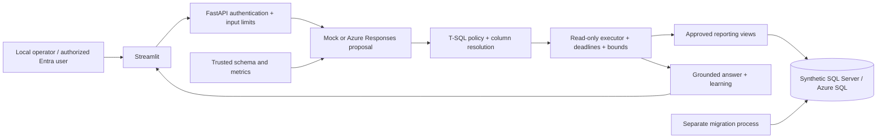

# Architecture

## Trust boundaries

The provider returns a strict Pydantic contract: `query` with SQL and typed parameters, or `clarify`
with a question. It cannot invoke a database, filesystem, shell or Python tool. FastAPI authenticates
before invoking the provider. The service passes every proposal through the gateway, including
subsequent/revised requests and practice submissions.

SQLGlot parses T-SQL, rejects unsupported AST nodes, resolves scopes against the catalog and validates
physical sources and columns. Parameter AST nodes render as ODBC `?` bindings in SQL rendering order;
values are never concatenated into SQL. Approved joins preserve job grain: many-to-one customer joins,
or a ranked-invoice relation with unchanged JobId, ROW_NUMBER partitioned by JobId, deterministic
InvoiceId ordering and rank = 1 in the join predicate. Other CTE/detail joins remain rejected.

The API owns bounded, authenticated-subject-scoped conversation memory. It supplies prior questions
and accepted proposal JSON to the provider as user/assistant messages, never as trusted instructions.
Clarifications retain the original question. SQL/parameters are retained only after successful validation
and execution; database results are excluded. Sessions are single-process, serialized and expire after
30 idle minutes. Limits return an explicit error rather than silently trimming context. The UI echoes
the server-issued conversation ID; New conversation deletes that memory and resets its display.

SQLAlchemy pools pyodbc connections; the runtime principal has object-level SELECT on seven views.
The database denies base-schema access. Ownership chaining allows approved same-owner views to read
base tables without caller base-table privileges. Migrations run in a separate process with credentials
absent from runtime containers.

The driver sets `SQL_ATTR_QUERY_TIMEOUT`; SQL Server receives `SET LOCK_TIMEOUT`. A semaphore bounds
concurrent statements. Result reading also has a total elapsed-time guard. Incremental fetching rejects
excess rows or bytes; it never inserts TOP or silently returns partial aggregates. A large scalar is
bounded after ODBC receives it; this is not a full database resource governor.

## Data and metrics

| Table | Grain | Rows | Relationship |
|---|---|---:|---|
| Customers | Customer | 60 | One customer → many jobs |
| Jobs | Job | 240 | One job → invoices and expenses |
| Invoices | Invoice | 480 | Two entries per job |
| Expenses | Expense | 720 | Labor, materials and travel per job |
| Targets | Month × region | 48 | Unique period/region pair |

All dates are in 2025. The deterministic seed includes completed, active and planned jobs, partial
invoicing, unfavorable budgets and zero invoicing. Zero-valued planned-job invoices are deliberate
synthetic test edges, not a claim about normal invoice-entry practice. `InternalNote` is an unauthorized
synthetic base-table column used for permission tests.

`vJobFinancials` aggregates each transaction table by JobId before joining. Joining raw invoice and
expense detail would triple invoice amounts and double expenses in this dataset. `vMonthlyPerformance`
aggregates by job-start month and region before joining targets. It describes lifetime amounts for job
cohorts, not transaction posting-month cash flows.

| Metric | Definition |
|---|---|
| Total Contract Value | Sum job ContractValue |
| Total Invoiced | Sum invoice Amount, or pre-aggregated job TotalInvoiced |
| Total Expenses | Sum expense Amount, or pre-aggregated job TotalExpenses |
| Gross Margin | Total Invoiced − Total Expenses |
| Gross Margin Percentage | 100 × Gross Margin / Total Invoiced; NULL for zero denominator |
| Job Count | Count job-grain rows |
| Budget Variance | Sum job budget − Total Expenses; positive is favorable |

Currency is CAD. Invoiced is not cash collected; contract value is not recognized revenue. Clarify
“revenue” before choosing either. Ratios aggregate numerators and denominators first.

## Answers and learning

Answers are deterministic summaries of returned cells, not another model completion. Retrieved text
never becomes model instructions. Streamlit renders it as plain text. Lessons come from the validated
AST and trusted grain metadata. Pandas is used only after the API has bounded results. Decimal amounts
travel as strings; the UI converts numeric columns for presentation and charts.

Practice uses separately authored SQL and committed Decimal fixtures. The reference SQL must still
match the fixture before a candidate passes. Comparison preserves duplicates, ignores row order and
compares numbers to cents by column position. It establishes fixture equivalence only, not a proof for
all possible datasets. Schema/seed changes require explicit fixture review.

`QueryBackend` isolates execution from orchestration. `FabricSQLBackend` refuses execution until M3
curated-table policy and capability tests are approved. Ingestion and semantic-model writes never
become query-agent tools.
