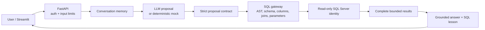

# SQL Intelligence Agent

**Ask a business question in plain English. Inspect the SQL. Verify the answer. Learn how the query works.**

A natural-language analytics agent for SQL Server, built with Python, FastAPI, Streamlit and an LLM
(GPT-4.1 mini). The model proposes SQL but never touches the database: every proposal passes through a
SQL policy gateway and runs under a read-only database identity. Accuracy is measured against
independently written reference queries, not graded by the model itself.

A built-in **SQL Learning Mode** explains each generated query and lets you practice writing your own
version, which is checked against the same reference results.

All business data is synthetic (financial amounts in CAD).


## What it does

- Answers questions involving filtering, aggregation, financial ratios and approved multi-table joins.
- Generates CTEs, scalar subqueries, `ROW_NUMBER`, `RANK`, `LAG` and running totals.
- Asks a clarifying question when a business term is ambiguous instead of guessing.
- Returns complete, bounded results along with the exact SQL and parameters it ran.
- Explains each query (grain, joins, filters, window functions) from the parsed SQL.

Example question:

> For every job, show the invoice with the highest amount. Include JobID, InvoiceID, and Amount.
> Use ROW_NUMBER(). Include jobs without invoices with NULL values. Break ties by the lowest InvoiceID.
> Order by JobID.

The live run returned **240 rows, each independently verified**. A separate edge-case database tests
jobs without invoices and tied amounts.

## Architecture



See [ARCHITECTURE.md](ARCHITECTURE.md) for the trust boundaries, data model and metric definitions.

## Key design decisions

- **The model proposes, code decides.** The LLM returns a typed contract (a query with parameters, or a
  clarifying question). It has no database connection, shell or tools.
- **SQL is parsed, not pattern-matched.** SQLGlot parses every proposal into an AST and rejects anything
  outside an allowlist of views, columns, joins and functions. One `SELECT` (or non-recursive CTE) only.
- **Security is enforced twice.** Even if the gateway missed something, the database identity can only
  read seven reporting views. Tests confirm real database-level denials for base tables, writes and DDL.
- **Fan-out is prevented in the data model.** Financial views pre-aggregate invoices and expenses
  separately, so joining them cannot double-count revenue.
- **Parameters are always bound.** Values are passed as typed ODBC parameters, never concatenated into SQL.
- **Hard limits, visible failures.** Ten-second query deadline, 500 rows, 256 KiB. Oversized results fail
  loudly instead of being silently truncated.

## Results

The acceptance suite has **61 cases: 53 analytical queries and 8 clarification or refusal cases**,
including 26 questions outside the original demo catalog. Every expected result was written as an
independent reference query and frozen before live testing.

| Verification | Result |
|---|---:|
| Live queries, fresh model calls | **53/53** |
| Clarification and refusal cases | **8/8** |
| Recorded replay, no model calls | **61/61** |
| Regression suite (Windows and Linux) | **466/466** |
| Security tests / direct database denials | **219/219 / 6/6** |

The first live batch passed **35/61**. Failures came from rate-limit errors and incorrect SQL proposals;
each was diagnosed, fixed and retested. All earlier failures are kept in
[evaluation/recordings](evaluation/recordings). See [EVALUATION.md](EVALUATION.md) for the methodology.

This is a finite acceptance set. It does not prove the agent writes correct SQL for every question, and
passing validation does not guarantee a query answers the intended business question.

## SQL Learning Mode


- **Generated SQL** shows the validated statement and its bound parameters.
- **Learn & practice** explains table grain, filtering, aggregation, joins, CTEs, window functions,
  `NULLIF` and ordering, based on the actual parsed query.
- **27 practice exercises** compare your SQL to an independent reference. Column order, duplicates,
  exact numbers, NULLs and required ordering all count: a query returning `COUNT(*) + 0.001` fails.

See [SQL_LEARNING.md](SQL_LEARNING.md) for examples.

## How to run

Requires Docker Desktop and Python 3.10 to 3.12. Mock mode needs no API key and makes no model calls.

```powershell
# Windows
.\local.cmd start --mode mock --open-browser
.\local.cmd stop
```

```bash
# Linux / macOS
bash ./local.sh start --mode mock
bash ./local.sh stop
```

Open [http://127.0.0.1:8501](http://127.0.0.1:8501) and choose **Show total invoiced by region**:

| Region | Total invoiced (CAD) |
|---|---:|
| Central | 1,691,724.00 |
| East | 1,697,952.00 |
| North | 1,704,180.00 |
| West | 1,131,968.00 |

The synthetic database has 60 customers, 240 jobs, 480 invoices, 720 expenses and 48 monthly targets.
All services bind to `127.0.0.1` only.

**Live mode** uses an Azure OpenAI deployment of GPT-4.1 mini. Copy `.env.example` to `.env`, set
`AZURE_OPENAI_ENDPOINT`, `AZURE_OPENAI_DEPLOYMENT` and `AZURE_OPENAI_API_KEY`, then run
`.\local.cmd start --mode live`. Details are in [LIVE_AZURE_OPENAI.md](LIVE_AZURE_OPENAI.md).

**Run the test suite** (real SQL Server, zero model calls):

```powershell
docker compose --profile test run --build --rm tests
```

GitHub Actions runs the same offline suites on every push.

## Limitations

- The supported T-SQL is deliberately narrower than everything SQL Server accepts, so some harmless
  queries are rejected. Only reviewed join patterns are allowed.
- New phrasings can still produce wrong or rejected SQL despite a passing acceptance suite.
- Business terms like "revenue" are not guessed; the agent asks instead.
- Conversation memory holds 12 turns, expires after 30 idle minutes and is not shared across instances.
- Synthetic fixtures cannot prove behavior on every real dataset.

## What I'd do next

- Connect to a Microsoft Fabric warehouse as a second backend (designed in
  [FABRIC_INTEGRATION.md](FABRIC_INTEGRATION.md), not yet enabled).
- Grow the acceptance suite with questions written by business users rather than by me.
- Persist conversations and usage budgets so the app can run as more than one instance.

## Repository layout

```
backend/      API, agent, SQL gateway, database adapters
frontend/     Streamlit UI
sql/          schema, reporting views, permissions, seed data
evaluation/   acceptance cases, reference results, recorded runs
tests/        unit, integration, security and evaluation tests
scripts/      local setup, seeding and evaluation runners
```

## How this was built

Built with AI coding assistants as pair programmers. The architecture, security model, evaluation
design and acceptance cases are mine, and every change was reviewed before merging.

## Author

Tony Testa: [github.com/t-testa](https://github.com/t-testa) · [linkedin.com/in/tony-testa-ai](https://www.linkedin.com/in/tony-testa-ai)
