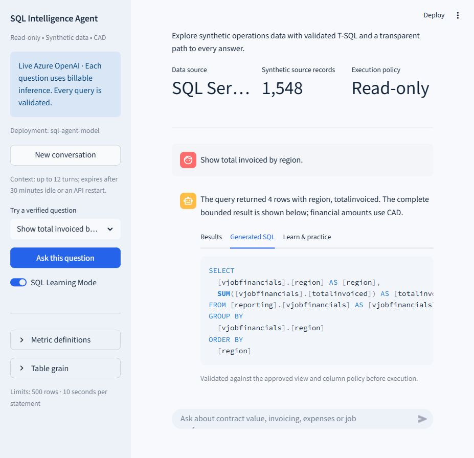
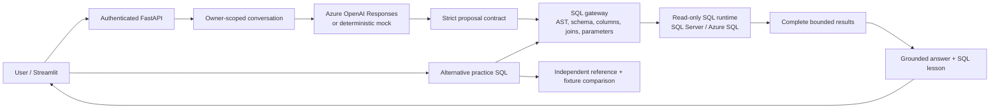
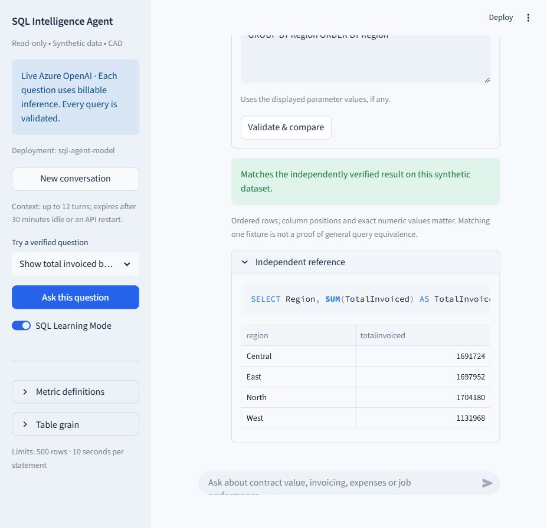

# SQL Intelligence Agent

**Private source • Private Azure application • Owner-approved Entra access only**

This complete repository must remain **PRIVATE**. Application access and GitHub source access are
granted and revoked independently. A separate sanitized public showcase is planned only after explicit
content approval; no application source, executable backend, secrets or usable endpoints will be public.
GitHub API metadata confirmed [t-testa/sql-intelligence-agent](https://github.com/t-testa/sql-intelligence-agent)
is **private**, with Pages disabled, on October 8, 2026. See the [source publication audit](docs/GITHUB_PUBLICATION.md).

**Ask a business question. Inspect the SQL. Verify the answer. Learn how the query works.**

A Python portfolio application combining **Azure OpenAI, FastAPI, Streamlit and SQL Server**.
Live inference generates new analytical queries; a SQL policy gateway and a restricted database identity
control execution. **SQL Learning Mode is a permanent feature**, including independent practice comparisons.

All shipped business data is synthetic; its financial amounts are CAD. Cloud hosting remains gated by
authentication, Azure acceptance tests and explicit owner approval.



## Demonstrated capabilities

- Natural-language filtering, aggregation, financial ratios and approved multi-table joins.
- Nonrecursive CTEs, scalar subqueries, ROW_NUMBER, RANK, LAG and running totals.
- Highest invoice per job with explicit NULL handling and deterministic tie-breaking.
- Bounded conversation context and clarification of ambiguous business definitions.
- Complete bounded results, generated SQL/parameters, AST-based explanations and learning exercises.
- A deterministic 27-question mock catalog and recorded live replay without cloud API charges.

For example:

> For every job, show the invoice with the highest amount. Include JobID, InvoiceID, and Amount.
> Use ROW_NUMBER(). Include jobs without invoices with NULL values. Break ties by the lowest InvoiceID.
> Order by JobID.

The live API smoke test returned **240 independently verified rows**. A second edge fixture tests jobs
without invoices and equal-amount ties. New live questions do not need to be added to the mock catalog.

## Architecture



The model proposes SQL and never receives a database connection. Only seven reporting views are
exposed. Financial views pre-aggregate invoice and expense facts independently to prevent fanout.
See [architecture](ARCHITECTURE.md), [security](SECURITY.md) and [threat model](THREAT_MODEL.md).

## Accuracy and release status

The independent acceptance suite has **61 cases: 53 analytical queries and 8 clarification/refusal
cases**, including 26 queries outside the original mock catalog. All 53 independently written reference
queries match deterministic Python Decimal fixtures. Real live testing targets **sql-agent-model**
(**gpt-4.1-mini 2025-04-14**, Canada East), not a mock.

Current results, exact failure rates, retests, model receipts and release blockers are recorded in
[the final verification report](docs/RELEASE_VERIFICATION.md). Earlier failures remain in
[evaluation/recordings](evaluation/recordings), including quota errors and incorrect SQL proposals.
The expected results were frozen before live testing.

| Final October 8 verification | Result |
|---|---:|
| Fresh live queries | **53/53 (100%)** |
| Clarification/refusal cases | **8/8 (100%)** |
| Recorded replay, no cloud calls | **61/61** |
| Windows / Linux regression suites, including portability | **466/466 each** |
| Mandatory security tests / direct database denials | **219/219 / 6/6 each** |

The initial live batch passed 35/61; quota and proposal failures were corrected and retested. Local
acceptance passes. The delegated frontend adapter and independent API authorization pass offline tests;
actual tenant configuration, private routing and Azure identity/database acceptance remain open. See
[private deployment verification](docs/PRIVATE_VERIFICATION.md).
The later [portability report](docs/PORTABILITY_VERIFICATION.md) records launch/stop tests, two fresh
live smoke results, corrected operational failures and the latest full regression runs.

This is a measured, finite development acceptance set. It does **not** establish universal SQL
correctness, general query equivalence or zero hallucinations. Passing SQL validation alone does not
establish that the query answers the intended business question.

## Quick start — no Azure required

Prerequisites: Docker Desktop with Linux containers/Ubuntu WSL integration and Python 3.10–3.12.
Run from the repository root:

```powershell
.\local.cmd start --mode mock --open-browser
# Stop without deleting SQL data or configuration:
.\local.cmd stop
```

Open [the local application](http://127.0.0.1:8501/) and choose **Show total invoiced by region**.
The launcher initializes only when needed and leaves an existing `.env` unchanged.
Ubuntu uses `bash ./local.sh start --mode mock`.
See [portable local deployment and desktop shortcuts](docs/LOCAL_PORTABLE.md).

| Region | Total invoiced (CAD) |
|---|---:|
| Central | 1,691,724.00 |
| East | 1,697,952.00 |
| North | 1,704,180.00 |
| West | 1,131,968.00 |

The normal seed has **60 customers, 240 jobs, 480 invoices, 720 expenses and 48 targets**.
SQL, API and UI ports bind only to 127.0.0.1: 14339, 8000 and 8501. A generated local bearer token
protects API operations. The frontend uses it server-side and has no SQL credentials.

## Live Azure OpenAI

Use the already approved existing deployment; see [the complete live runbook](LIVE_AZURE_OPENAI.md).
Privately configure `AZURE_OPENAI_ENDPOINT`, `AZURE_OPENAI_DEPLOYMENT=sql-agent-model` and
`AZURE_OPENAI_API_KEY` in ignored `.env`; set `AZURE_OPENAI_MAX_OUTPUT_TOKENS=1000`.
Preserve existing SQL credentials and `LOCAL_API_TOKEN`.

```powershell
.\local.cmd start --mode live --open-browser
# This next command makes one billable inference call:
.\local.cmd verify-live --allow-cloud-call
```

The sidebar must say **Live Azure OpenAI** and show the deployment. The helper checks the running
provider, submits the highest-invoice question through the authenticated API, then compares every row
against an independent Python oracle. Starting the UI does not itself call the model. Host Python
can use Azure identity instead of a resource key; cloud hosting requires managed identity and Entra.

Return to mock mode with `.\local.cmd start --mode mock`.
There is no automatic fallback from a failed live request to a mock answer.

## Temporary Azure lab and long-term local use

The [Azure lab runbook](docs/AZURE_LAB_RUNBOOK.md) covers approved private provisioning, real Entra/MI
acceptance, accuracy/security evidence, rollback and complete cleanup. The model is reused outside
the disposable application group. Preserve the local checkout, private configuration and approved
model access; deleting the application group then does not require abandoning local use or future
redeployment. See [actual verification status](docs/PORTABILITY_VERIFICATION.md); prepared cloud
templates and local passing tests are not a claim that Azure acceptance has already passed.

## SQL Learning Mode



Learning Mode remains available in both live and mock modes. **Generated SQL** shows the validated
statement and bound parameters. **Learn & practice** explains table grain, filtering, aggregation,
joins, CTEs, windows, NULLIF and ordering from the actual parsed SQL.

Twenty-seven exercises have independently authored references. An alternative query passes through
the same SQL gateway and database identity before comparison. Column positions, duplicate counts,
exact numeric values, NULLs and required ordering matter. A query returning `COUNT(*) + 0.001` fails;
small errors are not rounded away. Arbitrary new questions receive lessons but need a reviewed oracle
before receiving an independent practice exercise. See [learning examples](SQL_LEARNING.md).

## Security boundaries

- Entra single-tenant sign-in and sole approved user; FastAPI independently validates signature,
  tenant/audience/time, user, delegated scope and calling frontend. Local mode trusts one desktop operator.
- Private ACA environment and SQL endpoints; deployment defaults API access off. Missing/expired
  frontend authentication clears displayed results and requires sign-in again; no local-token fallback.
- Strict SQL AST, view, column, join and function allowlists; typed ODBC parameters.
- Actual database-level denials for base-table reads, internal fields, writes and object creation.
- One SELECT/nonrecursive CTE only; no dynamic SQL, procedures, external/system tables or unsafe joins.
- Ten-second SQL deadline, three concurrent queries, 500 rows and 256 KiB; oversized results fail visibly.
- Inference request/token/daily budgets, bounded output and no automatic provider retries.
- Learning Mode and follow-up questions cannot bypass any production authorization check.
- Secrets stay out of Git, images, screenshots and application audit logs; source data is synthetic.

Process-local budgets reset on restart and are not a cloud spending cap. Broad access requires persistent
quotas, durable audit/monitoring and a security review. See [SECURITY.md](SECURITY.md).

## Reproduce the evaluation

For host development, create `.venv`, install `requirements-dev.lock` and Microsoft ODBC Driver 18,
then follow [the live runbook](LIVE_AZURE_OPENAI.md) or use the Docker test profile:

```powershell
docker compose --profile test run --build --rm tests
```

This runs real SQL Server reference, replay, security and Learning Mode tests with **zero model calls**.
The test profile forces mock mode and clears Azure credentials. GitHub Actions runs the same offline
and container suites. Locally, Ruff and strict mypy also run:

```powershell
.\.venv\Scripts\ruff.exe check .
.\.venv\Scripts\ruff.exe format --check .
.\.venv\Scripts\mypy.exe
```

The [test methodology](EVALUATION.md) explains the frozen cases, separate edge database, independent
oracles, complete-result comparison, deterministic narration, replay and failure classification.
It does not use a model to grade its own output.

## Azure deployment

Read [the private Azure release plan](docs/AZURE_RELEASE_PLAN.md) and
[Entra configuration runbook](docs/PRIVATE_AUTH.md). It reuses existing Azure OpenAI and proposes private
Azure SQL Basic, an internal Container Apps environment, separate managed identities, protected token
storage, monitoring and an approved private browser route. Templates have compiled, not been applied.

The light-use subtotal is **about US$40–80/month before private user connectivity**; a new VPN/private
DNS resolver needs a separate quote. This is not an approved total. Continuous sessions can cost more.
Identity and predeployment checks must finish before requesting provisioning approval; real platform
and SQL acceptance follow approved private provisioning before application use.

**No new billable resources, access grants, collaborators or public publication are authorized.**
The [showcase plan](docs/PUBLIC_SHOWCASE_APPROVAL.md) defines permitted sanitized content for later
review; no separate showcase has been created or published. The full source stays private.

## Limits and known risks

- Supported T-SQL is deliberately narrower than all valid SQL Server syntax; harmless unsupported SQL
  can be rejected. Only reviewed customer and ranked-invoice joins are authorized.
- MonthlyPerformance uses job-start cohorts and lifetime job amounts. Invoice-date trends use vInvoices.
  “Revenue,” cash collected and business success are not guessed.
- Conversations hold up to 12 accepted turns, expire after 30 minutes idle/restart, and do not include
  result cells. Full/expired context returns an explicit error. History is not durable across replicas.
- New phrasings can generate wrong or rejected SQL despite a passing acceptance corpus.
- Finite synthetic fixtures cannot prove behavior on every dataset. Cloud SQL and actual tenant identities
  require separate deployment verification.
- Fabric/Power BI integration is documented future work; the Fabric backend remains disabled.

Repository map: `backend/` API, agent, policy and database adapters; `frontend/` UI; `sql/` schema,
views and baseline fixtures; `scripts/` local bootstrap/evaluation; `tests/` regressions;
`evaluation/` private synthetic evidence; `infrastructure/` undeployed private templates.

Stop locally with `docker compose stop`. `docker compose down` preserves the database volume.
Only use `docker compose down -v` when intentionally deleting this project's synthetic databases.
