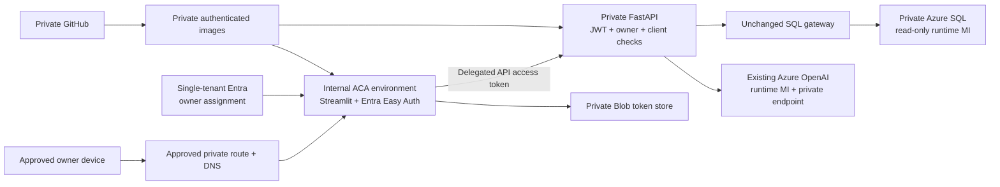

# Private Azure release plan

Updated October 8, 2026. **The full repository and application remain private.** This supersedes the
earlier public-demo proposal. No public application endpoint is planned. No source publication,
collaborator invitation, tenant grant or provisioning is authorized by this document.

The owner subsequently authorized routine private deployment work, subject to a cost exception for
new fixed charges. Read the [executed preflight and exact proposal](AZURE_PREFLIGHT_2026-10-08.md):
identity metadata and what-if are verified; new billable provisioning remains blocked on that exception.

Local accuracy validation passed: 61/61 actual live cases, with earlier failures retained. See
[accuracy evidence](RELEASE_VERIFICATION.md) and [private-access verification](PRIVATE_VERIFICATION.md).
SQL Learning Mode remains permanent. No new exercises are needed for deployment.

The deployment now has two required operating modes: a temporary private Azure engineering lab and
an independently runnable local Docker Desktop/Ubuntu WSL application. Use the
[reproducible Azure lab runbook](AZURE_LAB_RUNBOOK.md) for provisioning through cleanup and the
[portable local runbook](LOCAL_PORTABLE.md) for launch/stop and desktop shortcuts. Actual verification
is tracked [separately for each mode](PORTABILITY_VERIFICATION.md).

## Independent access boundaries

| Asset | Access control | Initial access |
|---|---|---|
| Full source/history/CI artifacts | PRIVATE GitHub repository | Owner-created `t-testa/sql-intelligence-agent`; private visibility verified |
| Application | Private route + single-tenant Entra + explicit assignments | Sole owner explicitly approved; identifiers saved in ignored private configuration |
| FastAPI | Independent JWT verification on every protected route | Approved object ID, API audience, frontend client and delegated scope |
| Azure SQL | Private endpoint/NSG + read-only managed identity | API runtime; separately approved migration administrator |
| Azure OpenAI | Existing resource + runtime MI + planned private connectivity | API runtime through authenticated operations |
| Images | Private ACR repositories; no anonymous pull/admin password | Approved build identity; API/frontend AcrPull identities |
| Public showcase | Separate future static, sanitized content | Nothing created/published; explicit content approval required |

GitHub access grants no application access; application users need neither GitHub access nor Azure
management roles. Never infer approved Entra identity from GitHub or Azure CLI login.

## Private topology

The environment is **internal** with `publicNetworkAccess=Disabled`. API ingress `external=false`
limits it to that environment. Frontend ingress `external=true` admits the private browser route from
outside the environment, **within the private network**. Never use the frontend template with an
external environment. Preflight rejects that reuse. Microsoft's
[networking model](https://learn.microsoft.com/en-us/azure/container-apps/networking) explains the distinction.

Reuse an approved VPN/connected workstation/private route where possible. Select its source subnet,
private DNS resolution and return routes before provisioning approval. Never enable public ingress
as a connectivity workaround. The browser subnet must not reach SQL/token storage. Endpoint NSG rules
allow application-subnet 443/1433, optionally 1433/443 from an explicitly approved maintenance subnet,
and deny other inbound traffic. SQL Proxy connection policy keeps the reviewed SQL path on 1433.
Actual effective NSG rules, routes and private DNS require cloud acceptance tests.

The foundation now reuses OpenAI; it creates no new account/model and makes no role assignments.
Creating its private endpoint does not disable existing public/key access. Review existing consumers
and explicitly approve any network/auth change. Preserve an independently approved local access path
outside the disposable application group; a cutover that breaks local portability is not acceptable.
Only runtime MI receives resource-scoped Cognitive Services OpenAI User;
the frontend receives no SQL/model role. All endpoints and grants remain approval-gated.

## Authentication and release gates

Follow the [exact Entra runbook](PRIVATE_AUTH.md). Streamlit forwards the platform's delegated access
token from its websocket handshake. FastAPI verifies RS256 signature, issuer/tenant, audience, time
claims, approved user, delegated scope, v2 version and frontend client on every protected request.
Identity headers, ID tokens, app-only tokens and shared local credentials cannot substitute for it.
API access defaults **disabled** in the deployment template. Cloud API schema/docs are disabled.
Minimal liveness returns no data and never accesses SQL or OpenAI.

Easy Auth uses private Blob token storage. The stable API uses a secret containing an HTTPS
user-delegation SAS, scoped to the private container with read/write/delete. Storage shared-key/public
access is disabled. Plan SAS and OAuth credential rotation/expiry alerts before provisioning; never
put these values in Git, frontend environment variables or logs. See Microsoft's
[token-store configuration](https://learn.microsoft.com/en-us/azure/container-apps/token-store).

1. Explicit tenant/user approval is recorded. The owner subsequently identified
   `t-testa/sql-intelligence-agent` and authorized an audited private source push. GitHub API metadata
   confirms private visibility and Pages off; see the [source audit](GITHUB_PUBLICATION.md). Preserve
   these settings. Public mirrors/packages and collaborator invitations remain unauthorized.
2. Two single-tenant registrations, owner-only assignments and per-owner delegated consent now exist.
   Their metadata and the approved CLI owner were verified; enterprise sign-in stays disabled. The
   proposed staged callback gate needs explicit approval: configure the exact generated ACA hostname
   after internal foundation creation, with frontend ingress/API access off until auth is ready.
3. Finish private routing/DNS, reuse inventory, resource names, approved subnets, protected build path,
   expiry/rotation ownership and a dated cost quote. Compile templates and review a parameterized
   `what-if`. These read-only checks do not authorize deployment.
4. Request the grouped cost/sequence exception for the concrete preflight inventory. What-if succeeded
   with 33 proposed creations and no changes/deletions. No billable resource has been created.
   GitHub Actions contains no Azure deployment or public publication job.
5. After approval, provision privately with API access disabled; bootstrap synthetic SQL from the
   approved migration host, create the contained runtime MI user and apply reviewed grants/DENY.
   Build/scan images and deploy immutable digests to the private registry.
6. Before enabling use, test real platform login, refresh/logout, owner and denied users, revocation,
   managed identity, SQL permissions, DNS/TLS and network denial. These platform tests need actual
   infrastructure, unlike the identity/configuration checks completed before provisioning approval.
7. Repeat security tests, independent references, recorded replay and an approved paced live corpus
   against Azure SQL. Preserve Learning Mode. Failed gates mean no validated release; local SQL Server
   evidence is not Azure-hosted validation.

## Costs and safeguards

The [October 8 preflight quote](AZURE_PREFLIGHT_2026-10-08.md) replaces the incomplete earlier estimates.
Current public retail meters, complete cost assumptions and exact resource inventory are recorded there.
The fixed portion is approximately **$75.85/month**; light use totals **$82.56–96.86/month**, with an
**$85–100 planning allowance**. This includes two SQL Basic databases, all private endpoints/DNS,
ACR, ACA's previously omitted managed load balancer/outbound IP, and the private browser host.

The proposed temporary lab is **up to 72 hours, approximately $12–18**, with a requested **$20 before-tax
allowance** and at most 20 operator-VM hours. These costs materially exceed the earlier $20–40 monthly
target if resources are retained. Obtain the explicit exception before provisioning. Budget alerts
do not stop spending; a retained VM, database, endpoint or load balancer keeps accruing applicable costs.

The browser route uses free Bastion Developer with a reviewed Windows D2as v4 VM, deallocated between
sessions. No VPN, NAT gateway, paid Bastion, Private DNS Resolver or ACA environment private endpoint is
selected. The VM's public IP supplies outbound connectivity only; NSG rules deny public inbound traffic.
The application stays private. Closing Streamlit sessions permits scaling to zero; it does not remove
fixed infrastructure charges. See [ACA billing](https://learn.microsoft.com/en-us/azure/container-apps/billing).

Preserve one API process/replica, zero minimum replicas, 6 inference requests/minute, 18,000 estimated
tokens/minute, 100 attempts/rolling day, 1,000 output tokens and no SDK retries. SQL bounds stay at
10 seconds, three concurrent requests, 500 rows and 256 KiB with visible overflow errors. In-memory
budgets reset on restart; they are not spending caps. Broader/multi-replica use requires persistent quotas.

Monitor 429s, token use, API errors, SQL latency/timeouts/DTU, restarts, auth denials, credential expiry
and costs. Test alerts at 50/80/100% of the approved budget. Restrict logs and exclude headers, tokens,
secrets, questions and parameters. Never log `/.auth/me` or SDK request bodies. Budget alerts/log caps
do not stop Azure spending. No additional monitoring resources are created without approval.

## Grant, revoke, rollback and cleanup

New users, collaborators, Azure grants and public content all need explicit approval. Application grants
update Entra assignment, Easy Auth and FastAPI allowlists together; initial templates permit one user.
For last-user revocation or incidents, set `APPLICATION_ACCESS_ENABLED=false`, deactivate old API
revisions and test a previously valid JWT against every protected route. Removing an Entra assignment
alone does not immediately invalidate issued access tokens. Close sessions and verify denial.

GitHub revocation separately removes approved collaborator/team/token access; it does not change
Entra app access. Previously cloned source cannot be remotely erased. Application users need no Azure
Contributor/Owner. CI uses read-only repository permissions and no Azure credentials. Its privacy guard
detects a violation; it cannot stop an owner from manually changing repository visibility.

For rollback, disable access, preserve evidence, restore the previous immutable image, deactivate old
revisions and retest. For cleanup, inventory the dedicated group and approve deletion before
`az group delete`. Separately review removal of project-specific roles, consents, registrations,
images and token storage. Never delete the reused model resource or unrelated groups. Check remaining
resources and subsequent billing; stopped apps do not stop SQL, registry, endpoint, VPN or log charges.

The separate [showcase content plan](PUBLIC_SHOWCASE_APPROVAL.md) stays private until approved.

For this temporary lab, the deletion inventory must also include cross-group role assignments,
Entra objects, private endpoint connections on the reused model, peerings and DNS links. Preserve
redeployment inputs/evidence outside Azure and verify local live operation again after cleanup.
Never remove the model resource as part of deleting the dedicated application group.
